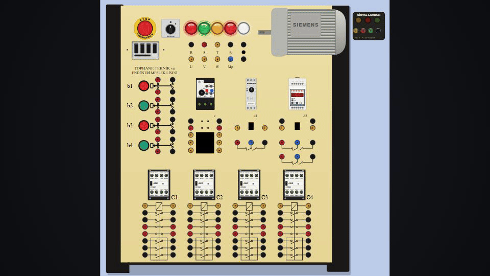
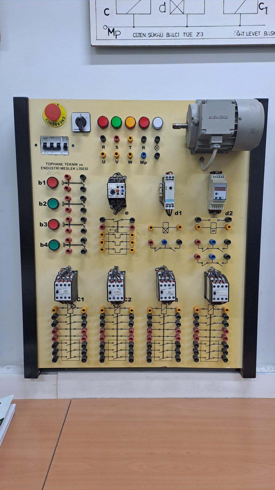
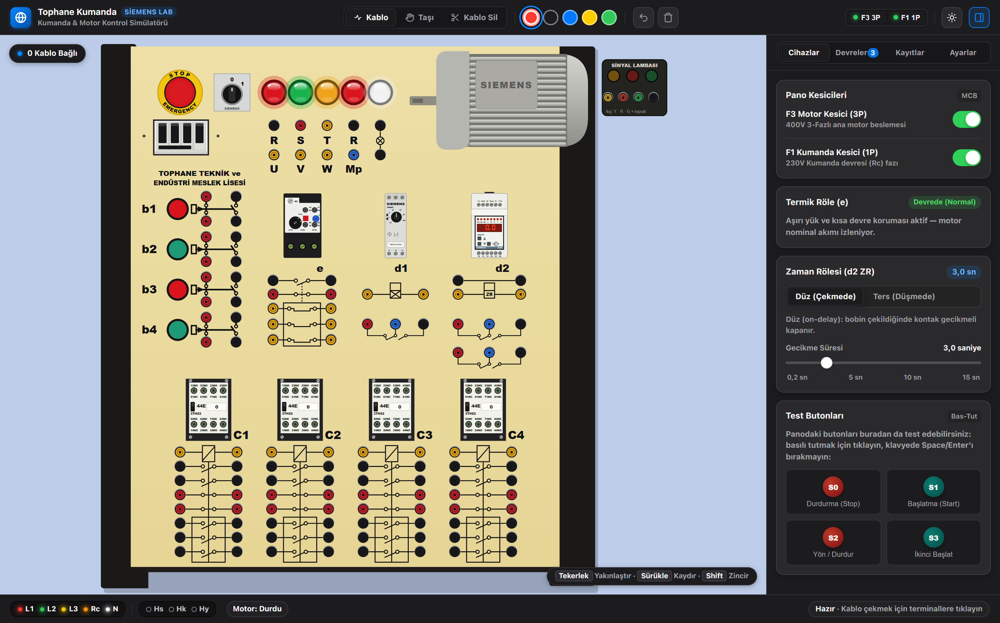
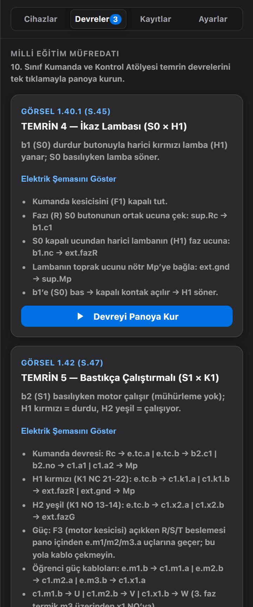
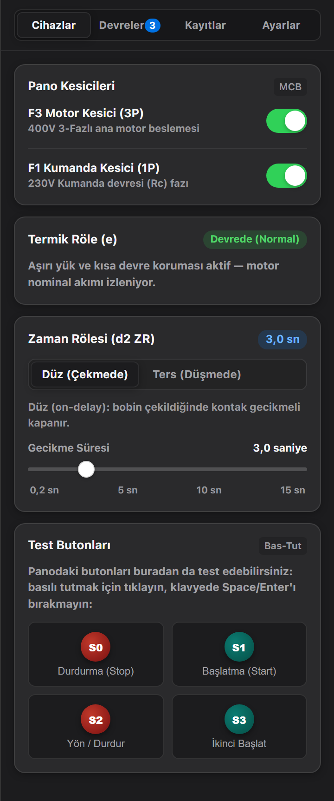
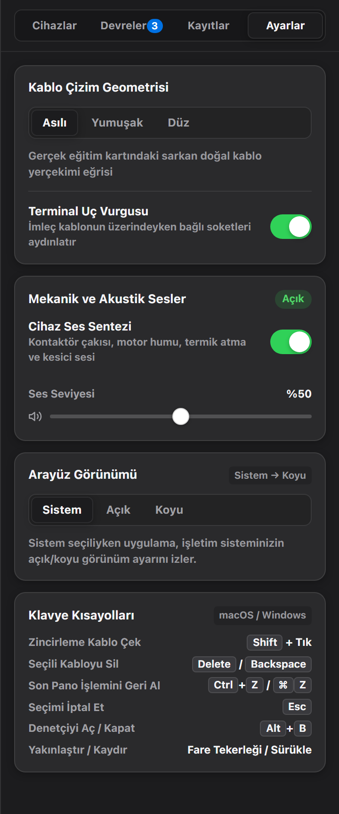
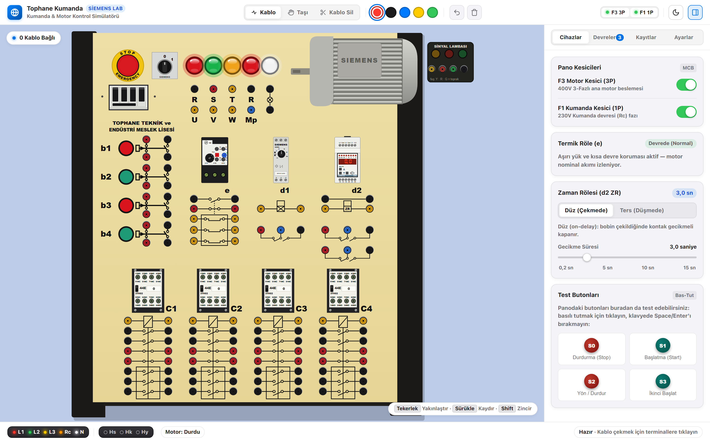
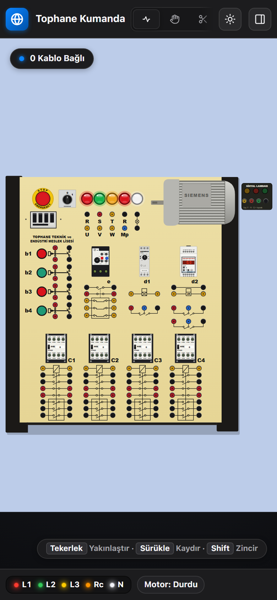

# tophanekumandaboard — Pano Simülatörü

**Kumanda ve Kontrol Atölyesi 10** (Tophane TEK ve EM L) için pano simülatörü:
gerçek seçmeli kumanda-motor kartının birebir SVG kopyası üzerinde kablo çek,
devreyi canlı çalıştır — lambalar, kontaktörler, termik röle, ZR zaman rölesi,
kısa devre ve motor davranışı gerçek zamanlı çözülür. MEB kitabındaki TEMRİN
devreleri tek tıkla kurulur; devreler tarayıcıya ve sunucuya kaydedilir.

Oluşturma: [T3 Code](https://t3.codes)

## 🎬 Simülasyon



*TEMRİN 5 devresi tek tek kuruluyor, sonra çalıştırılıyor — Remotion ile
gerçek pano bileşeni ve gerçek simülasyon motoru kare kare render edildi.*

**[MP4 — 1920×1080, tam kalite](docs/video/simulasyon.mp4)** ·
yeniden üretmek için: `npm run video:render`

## 📸 Ekran Görüntüleri

Pano sanatı, gerçek kartın fotoğrafından birebir modellendi:

| Gerçek pano (fotoğraf) | Simülatör (birebir SVG kopyası) |
| --- | --- |
|  |  |

Arayüz — koyu ve açık tema, denetçi çubuğu, mobil görünüm:

| Genel görünüm (koyu) | Devreler — MEB TEMRİN'leri |
| --- | --- |
|  |  |
| **Cihazlar** — kesiciler, termik, ZR, test butonları | **Ayarlar** — kablo stili, uç vurgusu, sesler |
|  |  |
| **Açık tema** | **Mobil görünüm (koyu)** |
|  |  |

## Devreler

| Devre | Ne yapar |
| --- | --- |
| **TEMRİN 4** — İkaz Lambası (S0 × H1) | b1 (S0) durdur butonuyla harici kırmızı lamba (H1) yanar; S0 basılıyken lamba söner. |
| **TEMRİN 5** — Bastıkça Çalıştırmalı (S1 × K1) | b2 (S1) basılıyken motor çalışır (mühürleme yok); H1 kırmızı = durdu, H2 yeşil = çalışıyor. |
| **TEMRİN 6** — Mühürlemeli Sürekli Çalıştırma | b2 (S1) ile başlatılır; c1.x3 mühürleme kontağı sürekli çalışmayı sağlar; b1 (S0) ile durur. |

Devreler sekmesinden mini devre şemaları ve adım adım kurulum açıklamalarıyla
tek tıkla panoya kurulur.

## Öne Çıkanlar

- **Birebir pano sanatı** — cihaz görselleri, soket koordinatları, baskılar ve
  dokular gerçek fotoğraftan hiç değiştirilmeden SVG'ye işlendi.
- **Kablo çekme** — 5 renkli palet; TTR (güç) kablosu kalın çizilir, ~120 birim
  yakınındaki güç ucunu otomatik yakalar; yol stili **Asılı / Düz / Yumuşak**.
- **Canlı çözücü** — lambalar, K1–K4 kontaktörleri, d1 röle, ZR sayacı (düz/ters),
  termik aşırı yük, kısa devre tespiti, motor yönü ve faz kayıpları.
- **Sentezlenen sesler** — kontaktör çakması, motor uğultusu, termik/short-circuit
  sesleri Web Audio ile kod içinde; `public/sounds/*.wav` konursa dosyalar kullanılır.
- **Kayıt** — tarayıcı + sunucu; JSON dışa/içe aktarma.
- **Apple HIG temelinde arayüz** — koyu/açık tema, WCAG AA kontrast,
  `prefers-reduced-motion` desteği; kısayollar: `Ctrl+Z` geri al, `Delete` sil,
  `Shift` zincir çekim.

## Çalıştırma

```bash
npm install           # çalışma alanları: apps/web (React 19 + Vite 7), apps/server
npm run dev           # http://localhost:5173  (proxy /api → :8787)
npm run server        # kayıt API — http://localhost:8787 (dosyada saklar)
npm run build         # apps/web: tsc -b && vite build
```

Sunucu kapalıyken kayıtlar yalnız tarayıcıya yazılır; uygulama çalışmaya devam eder.

### Simülasyon videosu (Remotion)

```bash
npm run video         # Remotion Studio'da canlı önizleme
npm run video:render  # → docs/video/simulasyon.mp4 (1920×1080, 30 fps)
npm run video:gif     # → docs/video/simulasyon.gif (README'de gömülü)
```

`apps/video` uygulama kodunu kopyalamaz: kompozisyon, gerçek `Board` bileşenini
ve saf simülasyon motorunu her karede baştan ileri saran belirleyici bir sürücüyle
render eder — video, uygulamanın ta kendisidir.

## Davranış Testleri

`behave.mjs` gerçek tarayıcıda (Puppeteer) motorun davranışını ölçer: TEMRİN 4/5/6
senaryoları, kısa devre → termik, ZR düz/ters zamanlama, motor yönü ve faz
hataları, kayıt API turu.

```powershell
npm run server        # önce kayıt sunucusu (:8787)
$env:CHROME = "$env:LOCALAPPDATA\ms-playwright\chromium-1248\chrome-win64\chrome.exe"
node behave.mjs
```

Son satır `PAGE_ERRORS: []` olmalı — sayfa hataları boş demektir. Ekran
görüntüsü için: `node shot.mjs <url> <out.png>` (CHROME yine gerekli).

## Mimari

```
apps/web/src/
  board/render.tsx      pano sanatı + kablo çizimi (birebir, kilitli)
  board/geometry.ts     soket tablosu — koordinatlar fotoğraftan, KİLİTLİ
  sim/                  çözücü (BFS) + model + React döngüsü
  audio/sfx.ts          ses sentezi + .wav örnek köprüsü
  store.ts              durum, localStorage, kayıt belgesi
  ui/                   başlık · cihazlar · devreler · kayıtlar · ayarlar · durum çubuğu
apps/server/index.mjs   /api/saves — dosya tabanlı CRUD
apps/video/             Remotion simülasyon videosu (kare sürücüsü + kompozisyon)
visual_spec.md          gerçek fotoğraftan okunmuş görsel envanter
```

Pano sanatı kasıtlı olarak kilitlidir: `geometry.ts` koordinatları ve `styles.css`
pano sınıfları değiştirilmez; arayüz kabuğu bu kilitin çevresinde tasarlanır.
Simge: `apps/web/public/icon.svg`.
